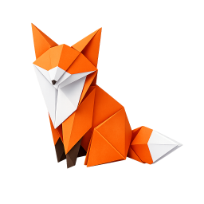
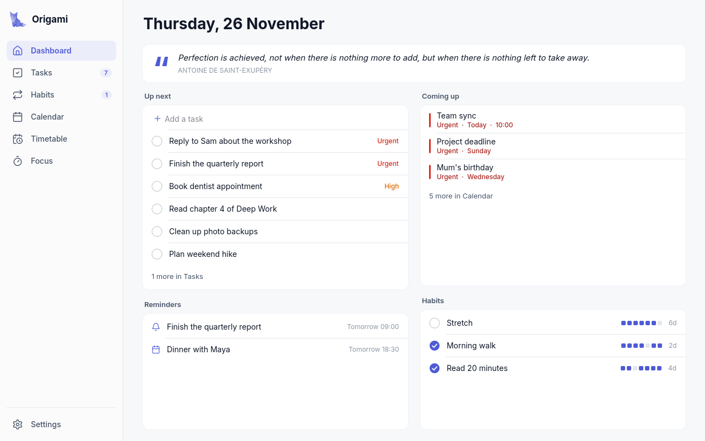
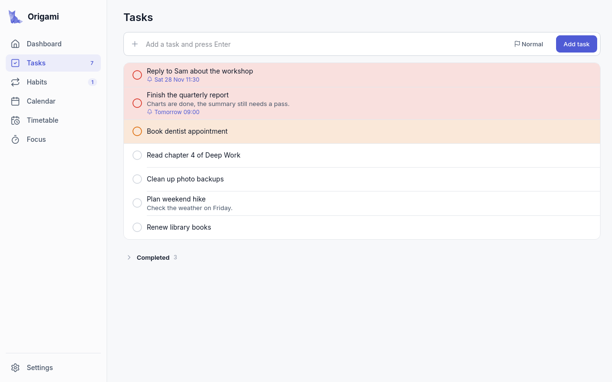
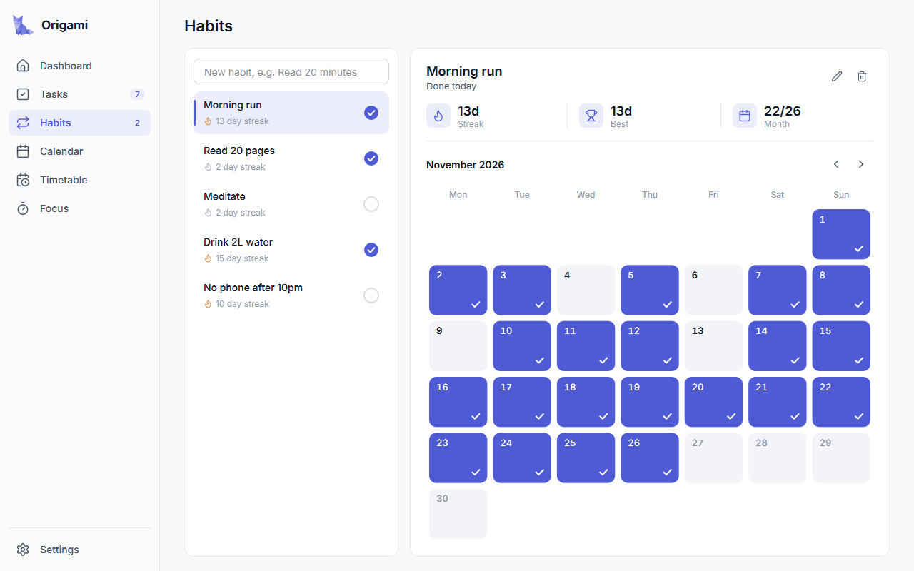
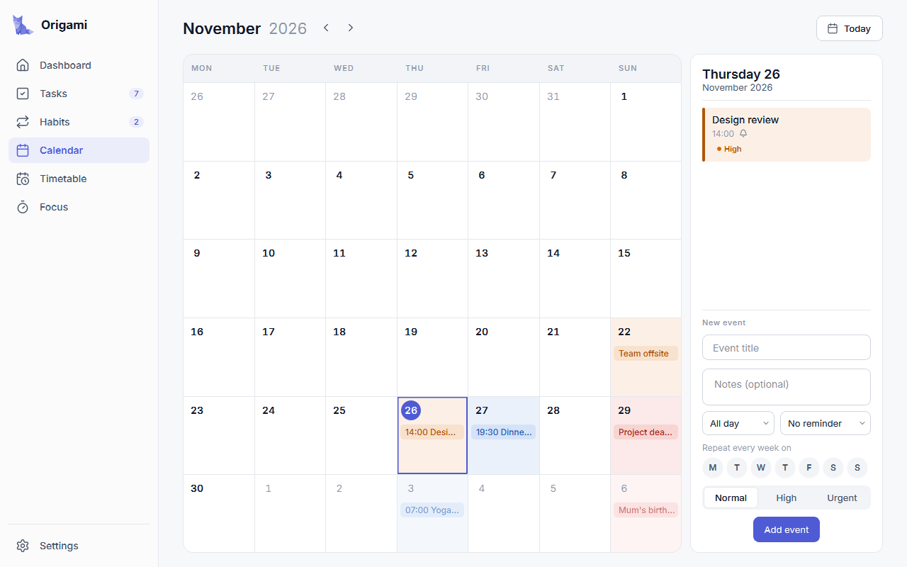
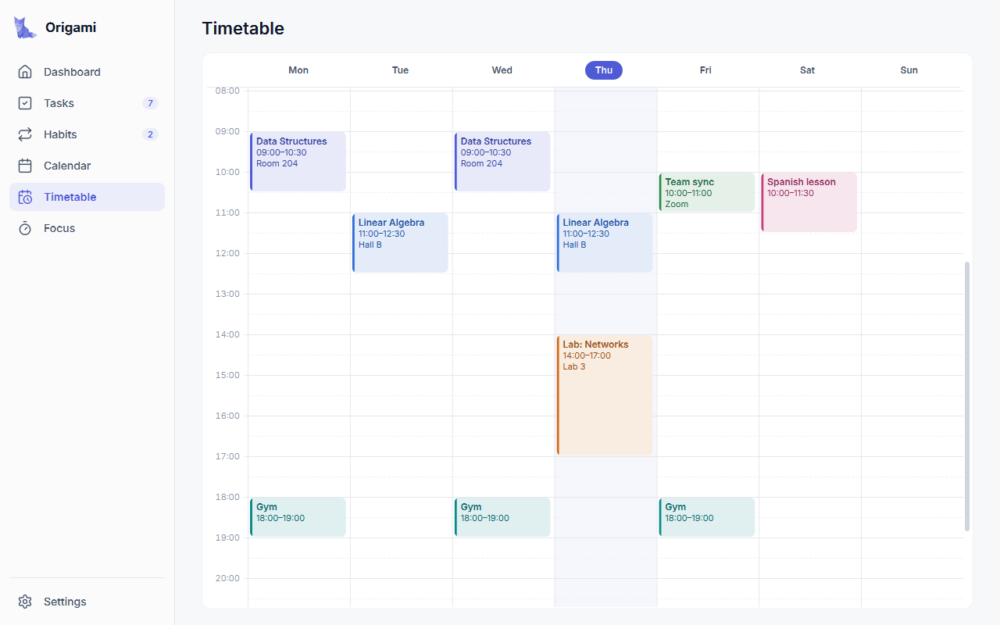
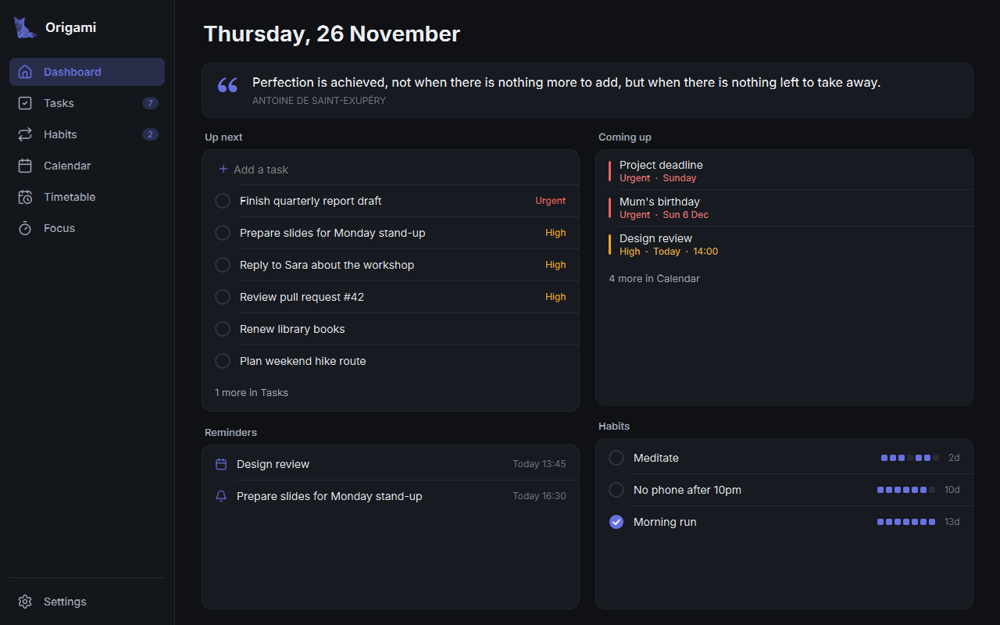
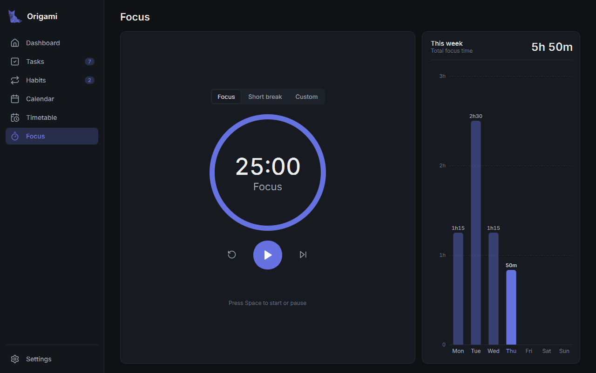

<p align="center">
  
</p>

<h1 align="center">Origami</h1>

<p align="center">
  A quiet desktop home for your tasks, habits, schedule and focus time.
</p>

<p align="center">
  
  
  
  <a href="LICENSE"></a>
</p>

<p align="center">
  
</p>

Most productivity apps want to be your whole operating system. Origami just wants to be the window you open in the morning. It shows what's due today, which habits you've kept up, what's coming this week and how much focused work you've actually done. Then it gets out of the way.

Everything stays on your computer in a single local database. You don't need an account and nothing syncs to anyone's cloud.

## What's inside

**Dashboard.** Today's date, a quote to start on, your next tasks, upcoming events, today's reminders and habit check-offs, all on one screen.

**Tasks.** One list, sorted by priority. Add notes and a reminder to any task. Finished tasks move to a Completed section so they're out of your way but still there if you need them.

**Habits.** Check a habit off for today, keep your streak going, and look back over the month to see how consistent you've really been.

**Calendar.** A month view with color-coded priorities, optional times, reminders and events that repeat weekly.

**Timetable.** A Monday-to-Sunday grid for the things that happen every week, such as classes, gym sessions and meetings. Each block can carry a location and a reminder.

**Focus.** A Pomodoro timer with focus, short-break and custom modes. Sessions are logged automatically, and a weekly chart shows where your hours went.

**And the small things:** light, dark or system theme, eight accent colors, adjustable text size, a `Ctrl+K` command palette, desktop notifications that keep arriving from the system tray, and one-click JSON export of everything.

## A closer look

<table>
  <tr>
    <td></td>
    <td></td>
  </tr>
  <tr>
    <td align="center"><sub>Tasks</sub></td>
    <td align="center"><sub>Habits</sub></td>
  </tr>
  <tr>
    <td></td>
    <td></td>
  </tr>
  <tr>
    <td align="center"><sub>Calendar</sub></td>
    <td align="center"><sub>Timetable</sub></td>
  </tr>
  <tr>
    <td></td>
    <td></td>
  </tr>
  <tr>
    <td align="center"><sub>Dark mode</sub></td>
    <td align="center"><sub>Focus</sub></td>
  </tr>
</table>

## Getting started

You'll need Python 3.10 or newer.

```bash
git clone https://github.com/meheraj-hossain95/origami.git
cd origami

python -m venv .venv
.venv\Scripts\activate        # macOS / Linux: source .venv/bin/activate

pip install -r requirements.txt
python main.py
```

You can also install it as a package with `pip install .` and launch it with the `origami` command.

## Keyboard shortcuts

| Shortcut | Action |
| --- | --- |
| `Ctrl+K` | Open the command palette |
| `Ctrl+1` to `Ctrl+6` | Jump to Dashboard, Tasks, Habits, Calendar, Timetable or Focus |
| `Ctrl+N` | New task |
| `Ctrl+,` | Settings |
| `Space` | Start or pause the timer (on the Focus page) |

## Where your data lives

Origami keeps everything in one SQLite file inside your system's app-data folder (`%APPDATA%\Origami` on Windows). **Settings → Open folder** takes you straight there. To keep the data somewhere else, such as a synced folder, set the `ORIGAMI_HOME` environment variable before you launch the app.

If you used Origami 1.x, your old tasks, events and settings are imported automatically the first time you run this version.

## Project layout

```
origami/
├── app.py          startup and wiring
├── store.py        SQLite data layer; emits a signal whenever something changes
├── timer.py        drift-free Pomodoro timer
├── reminders.py    checks for due reminders in the background
└── ui/
    ├── theme.py    colors, fonts and the single app-wide stylesheet
    ├── shell.py    main window, sidebar, tray
    ├── palette.py  Ctrl+K command palette
    └── pages/      dashboard, tasks, habits, calendar, timetable, focus, settings
```

Pages never talk to each other directly. Each one listens for change signals from the store and redraws itself. Because the whole look comes from one generated stylesheet, switching themes or accent colors is a single call.

## Credits

Typeface: [Inter](https://rsms.me/inter/) (SIL Open Font License). Icons: [Lucide](https://lucide.dev) (ISC).

## License

Origami is released under the [MIT License](LICENSE).
